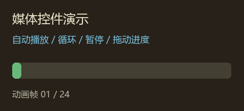

<!--mce:{"v":1,"Type":"text","Media":"","Align":"left","Width":100,"Indent":0,"Background":"","InlineWithPrevious":false}-->
# 山顶伙伴

<!--mce:{"v":1,"Type":"text","Media":"","Align":"left","Width":100,"Indent":0,"Background":"","InlineWithPrevious":false}-->
把便利留给操作，把冒险留给山峰。

<!--mce:{"v":1,"Type":"text","Media":"","Align":"left","Width":100,"Indent":0,"Background":"","InlineWithPrevious":false}-->
这是一份基于当前模组类型制作的示范草稿。分组和措辞可以自由修改；示例按键来自当前配置文件，不代表每个模组都已通过游戏内验证。

<!--mce:{"v":1,"Type":"rule","Media":"","Align":"left","Width":100,"Indent":0,"Background":"","InlineWithPrevious":false}-->
---

<!--mce:{"v":1,"Type":"text","Media":"","Align":"left","Width":100,"Indent":0,"Background":"","InlineWithPrevious":false}-->
## 一起登顶，先把设置找对

<!--mce:{"v":1,"Type":"text","Media":"","Align":"left","Width":100,"Indent":0,"Background":"","InlineWithPrevious":false}-->
模组概览负责查看模组、分组、版本、主页和依赖。快捷键设置把常用操作放在同一棵树里；齿轮可以打开对应模组的完整设置。

<!--mce:{"v":1,"Type":"text","Media":"","Align":"left","Width":100,"Indent":0,"Background":"#29493680","InlineWithPrevious":false}-->
**联机提醒**：整合包的键位和更新许可由作者预先整理。恢复蓝色整合包预设，通常更容易与这套整合包保持一致；自行改键后，请留意重复键提示。

<!--mce:{"v":1,"Type":"text","Media":"","Align":"left","Width":100,"Indent":0,"Background":"","InlineWithPrevious":false}-->
## 这套模组大致分成四类

<!--mce:{"v":1,"Type":"image","Media":"media/groups.png","Align":"left","Width":75,"Indent":0,"Background":"","InlineWithPrevious":false}-->

<!--mce:{"v":1,"Type":"text","Media":"","Align":"left","Width":100,"Indent":0,"Background":"","InlineWithPrevious":false}-->
### 基础与界面

<!--mce:{"v":1,"Type":"text","Media":"","Align":"left","Width":100,"Indent":0,"Background":"","InlineWithPrevious":false}-->
- **ModConfig Enhance**：统一整理模组概览、介绍、语言和快捷键。
- **Better MicIndicator / HUD Hider**：管理麦克风提示与 HUD 显示。
- **Better Player Distance**：帮助观察队友距离与状态。

<!--mce:{"v":1,"Type":"text","Media":"","Align":"left","Width":100,"Indent":0,"Background":"","InlineWithPrevious":false}-->
### 联机与协作

<!--mce:{"v":1,"Type":"text","Media":"","Align":"left","Width":100,"Indent":0,"Background":"","InlineWithPrevious":false}-->
- **BetterPeakVoiceFix**：围绕联机语音连接与同步提供修复。
- **peakReconnect / LateJoinFix**：提供重连及中途加入相关便利。
- **BetterPiggyback / BetterReviveOrTeleport**：用于背队友、复活和队友位置相关操作。

<!--mce:{"v":1,"Type":"text","Media":"","Align":"left","Width":100,"Indent":0,"Background":"","InlineWithPrevious":false}-->
### 地图与探索

<!--mce:{"v":1,"Type":"text","Media":"","Align":"left","Width":100,"Indent":0,"Background":"","InlineWithPrevious":false}-->
- **Foothold**：辅助观察可站立位置。
- **Random Terrain Enhance**：提供地形相关扩展。
- **EagleEye / ClimbInfoTracker**：望远镜与攀爬记录等探索工具。

<!--mce:{"v":1,"Type":"text","Media":"","Align":"left","Width":100,"Indent":0,"Background":"","InlineWithPrevious":false}-->
### 实用与性能

<!--mce:{"v":1,"Type":"text","Media":"","Align":"left","Width":100,"Indent":0,"Background":"","InlineWithPrevious":false}-->
- **ItemSpawner / PeakLevelSelect**：物品与关卡相关工具。
- **ClearComms / NoMoreMotionBlur**：声音和画面相关调整。
- **FrameDoctor**：观察性能问题的定位工具。

<!--mce:{"v":1,"Type":"rule","Media":"","Align":"left","Width":100,"Indent":0,"Background":"","InlineWithPrevious":false}-->
---

<!--mce:{"v":1,"Type":"text","Media":"","Align":"left","Width":100,"Indent":0,"Background":"","InlineWithPrevious":false}-->
## 快捷键：找得到，也改得明白

<!--mce:{"v":1,"Type":"text","Media":"","Align":"left","Width":100,"Indent":0,"Background":"","InlineWithPrevious":false}-->
当前配置中的示例：**HUD 开关 F10**、**飞行开关 F7**、**性能浮层 F7**。两个 F7 可以作为重复键信息的展示样例；最终以实际加载的模组和配置为准。

<!--mce:{"v":1,"Type":"text","Media":"","Align":"left","Width":100,"Indent":0,"Background":"","InlineWithPrevious":false}-->
<u>鼠标点击当前按键开始录制</u>；手柄选中后按确认。*按 Esc 或返回取消这一轮录制*。绿色按键恢复模组自带默认，蓝色按键恢复整合包预设。

<!--mce:{"v":1,"Type":"text","Media":"","Align":"left","Width":100,"Indent":0,"Background":"","InlineWithPrevious":false}-->
绿色 · 模组默认　蓝色 · 整合包预设

<!--mce:{"v":1,"Type":"text","Media":"","Align":"left","Width":75,"Indent":1,"Background":"","InlineWithPrevious":false}-->
~~所有重复键都必须删掉~~　不同场景可能允许复用同一个按键。先查看具体模组和功能，再决定是否调整。

<!--mce:{"v":1,"Type":"rule","Media":"","Align":"left","Width":100,"Indent":0,"Background":"","InlineWithPrevious":false}-->
---

<!--mce:{"v":1,"Type":"text","Media":"","Align":"left","Width":100,"Indent":0,"Background":"","InlineWithPrevious":false}-->
## 功能展示区

<!--mce:{"v":1,"Type":"text","Media":"","Align":"left","Width":100,"Indent":0,"Background":"","InlineWithPrevious":false}-->
以下单独展示排版功能；正文采用左对齐，居中与右对齐仅在本节作为示例。

<!--mce:{"v":1,"Type":"image","Media":"media/groups.png","Align":"left","Width":50,"Indent":0,"Background":"","InlineWithPrevious":false}-->

<!--mce:{"v":1,"Type":"image","Media":"media/groups.png","Align":"left","Width":50,"Indent":0,"Background":"","InlineWithPrevious":true}-->

<!--mce:{"v":1,"Type":"text","Media":"","Align":"left","Width":100,"Indent":0,"Background":"","InlineWithPrevious":false}-->
**粗体强调**、*斜体补充*、<u>下划线</u>与~~删除线~~可以放在同一段里。未设置背景的文字保持透明。

<!--mce:{"v":1,"Type":"text","Media":"","Align":"left","Width":100,"Indent":0,"Background":"","InlineWithPrevious":false}-->
大字号标题样例

<!--mce:{"v":1,"Type":"text","Media":"","Align":"left","Width":100,"Indent":0,"Background":"","InlineWithPrevious":false}-->
小字号补充说明：适合媒体说明、版本备注和较次要的提醒。

<!--mce:{"v":1,"Type":"text","Media":"","Align":"left","Width":25,"Indent":0,"Background":"#25343D90","InlineWithPrevious":false}-->
25% 宽度 · 左对齐

<!--mce:{"v":1,"Type":"text","Media":"","Align":"center","Width":50,"Indent":0,"Background":"#3B352590","InlineWithPrevious":false}-->
50% 宽度 · 居中

<!--mce:{"v":1,"Type":"text","Media":"","Align":"right","Width":75,"Indent":0,"Background":"#352A3D90","InlineWithPrevious":false}-->
75% 宽度 · 右对齐

<!--mce:{"v":1,"Type":"text","Media":"","Align":"left","Width":100,"Indent":1,"Background":"","InlineWithPrevious":false}-->
100% 宽度 · 缩进一级

<!--mce:{"v":1,"Type":"text","Media":"","Align":"left","Width":100,"Indent":0,"Background":"","InlineWithPrevious":false}-->
[打开 ModConfig Enhance 主页](https://github.com/AiAe-156/Peak-ModConfigEnhance)

<!--mce:{"v":1,"Type":"rule","Media":"","Align":"left","Width":100,"Indent":0,"Background":"","InlineWithPrevious":false}-->
---

<!--mce:{"v":1,"Type":"text","Media":"","Align":"left","Width":100,"Indent":0,"Background":"","InlineWithPrevious":false}-->
## 动图与短视频

<!--mce:{"v":1,"Type":"text","Media":"","Align":"left","Width":100,"Indent":0,"Background":"","InlineWithPrevious":false}-->
下方动图用于演示自动循环。单击或确认切换播放状态，拖动进度条查看位置，双击放大。编辑模式下，每种媒体都能通过缩放滑条调整10–100%的显示尺寸；鼠标与手柄均可使用。

<!--mce:{"v":1,"Type":"gif","Media":"media/playback.gif","Align":"left","Width":50,"Indent":0,"Background":"","InlineWithPrevious":false}-->

<!--mce:{"v":1,"Type":"text","Media":"","Align":"left","Width":100,"Indent":0,"Background":"","InlineWithPrevious":false}-->
下面的视频沿用你已经导入的素材，用来查看自动播放、暂停、进度和放大控件。视频播放结束后停止。

<!--mce:{"v":1,"Type":"video","Media":"media/existing-video.mp4","Align":"left","Width":75,"Indent":0,"Background":"","InlineWithPrevious":false}-->

<!--mce:{"v":1,"Type":"rule","Media":"","Align":"left","Width":100,"Indent":0,"Background":"","InlineWithPrevious":false}-->
---

<!--mce:{"v":1,"Type":"text","Media":"","Align":"left","Width":100,"Indent":0,"Background":"","InlineWithPrevious":false}-->
## 给一起出发的队友

<!--mce:{"v":1,"Type":"text","Media":"","Align":"left","Width":100,"Indent":0,"Background":"","InlineWithPrevious":false}-->
进入游戏后，先看看自己的语音与按键是否符合习惯。找不到选项时，从模组概览的齿轮进入对应设置；需要调整分组和说明时，再开启编辑模式。

<!--mce:{"v":1,"Type":"text","Media":"","Align":"left","Width":100,"Indent":0,"Background":"","InlineWithPrevious":false}-->
山顶见。
