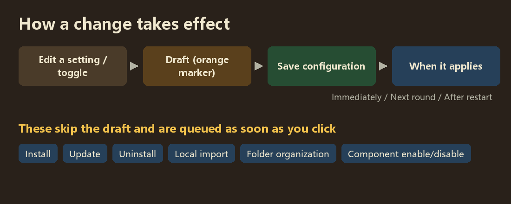
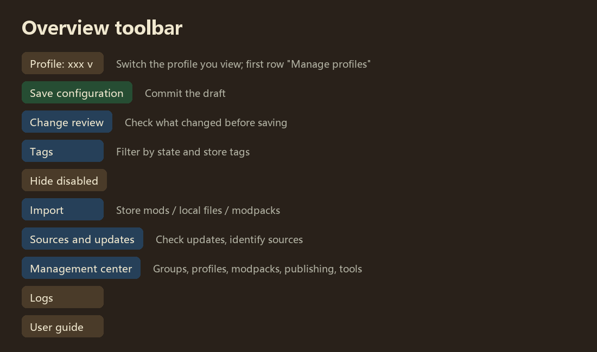
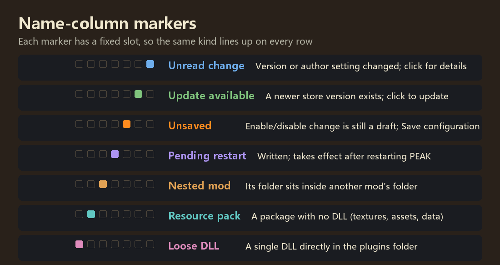
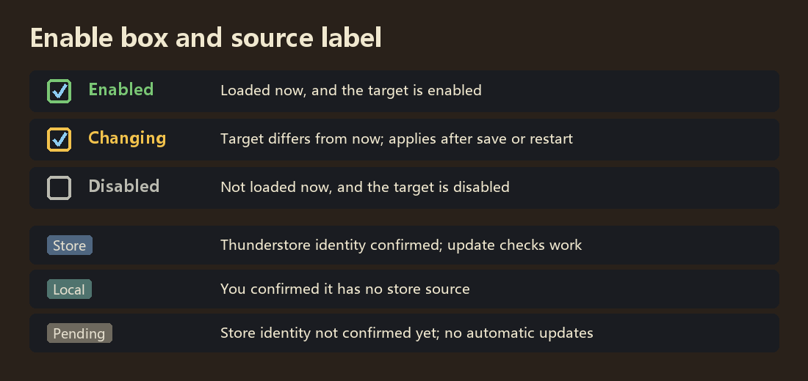

# In-Game Mod Manager {#top}

**View, enable, configure and update your mods, and manage modpacks, without leaving the game.**

In-Game Mod Manager (IGMM) puts the mod list, enhanced settings pages, hotkeys, translation, store updates and modpack tools in one place. If this is your first time, read "Three-minute start" and "Interface legend" below, and look up unfamiliar words in the glossary.

**Jump to**　[Three-minute start](#start) · [How a change takes effect](#flow) · [Interface legend](#legend) · [Glossary](#glossary) · [Safety rules](#safety) · [Chapters](#chapters)

---

## Three-minute start {#start}

Open **Mod overview** from the settings in the main menu or the pause menu.

1. **Find a mod**: type a name, author or keyword in the search box; the list filters after a short pause. Click the triangle beside a group to fold it.
2. **Change its settings**: click the **gear** on the mod's row to open its settings page. Hotkeys are on the **Hotkeys** tab at the top.
3. **Enable or disable**: tick or untick the **enable box** at the start of the row. An orange marker appears at the top right of the name: the change is still a draft.
4. **Save**: click the green **Save configuration** button. Settings apply at their own timing; enabling and disabling take effect the next time PEAK starts.

> **One rule to remember: changes go into a draft, and only Save configuration commits them.**
> Browsing, switching profiles and opening previews never save anything on their own.

Installing, updating and uninstalling **do not use the draft**; they are queued as soon as you click (next section).

## How a change takes effect {#flow}

There are two kinds of actions in the manager:

- **Drafted, applied on save**: settings, hotkeys, enabling/disabling mods, groups, modpack information, introductions. Before saving you can open **Change review** to check what changed and when it applies (immediately, next round, after a restart, or as the mod decides).
- **Queued straight away**: install, update, uninstall, local import, folder organization, enabling/disabling base components. The separate **update helper** runs them, independently of saving your configuration.

While the game is running, new mods do not wait for you to quit. The helper only waits until PEAK exits when it has to **replace a DLL that is already loaded** (updating a running mod, rolling back). See [Sources and updates](sources#update-queue).

## Interface legend {#legend}

### Overview toolbar

Button colours follow their function: **green** commits (Save configuration, Save hotkeys), **red** is destructive (uninstall, delete), **blue** (indigo in the purple theme) edits and chooses (profile, tag filter, Management center, language), **teal** (cyan in the purple theme) opens another window (Mod store, Logs), **grey** is an ordinary action (Refresh, More), and the **User guide** has a colour of its own (amber in the blue theme, rose in the purple theme).

When the window is narrow, buttons that do not fit move into **More**. The Management center has tabs for groups, profiles, modpacks, publishing and tools.

### Name-column markers

Each marker has a **fixed slot**, so the same kind lines up on every row. Hover over a marker (or focus it with a controller) to see what it means; click it for details.

### Enable box and source label

- The border colour compares the **current load state** with the **target**: green enabled, grey disabled, yellow means the target differs from now and applies after saving or restarting.
- A resource pack has no DLL, so it never shows as loaded; its box is green whenever its files are enabled.
- Source labels can be turned off in the manager's own settings.

## Glossary {#glossary}

- **Profile**: one set of settings, hotkeys and mod enable targets. You can have many; switching only lets you **view** another one, and saving applies it.
- **Author preset**: a profile supplied by a modpack author. The original is kept; after editing you can save it in place or as a personal profile, and restore the original at any time.
- **Modpack**: a whole mod environment (mod files, configs, profiles, introduction). The modpack library can hold several, and you can switch between them.
- **Modpack information**: groups, introduction, media and mod display names, shared by every profile of the current modpack.
- **Draft**: changes not saved yet. The orange marker beside a name and the `*` after a profile name refer to it.
- **Save**: write the draft into the profile and use it. There is no separate "apply" step.
- **Effect timing**: when a saved value actually takes effect: immediately, next round, after restarting the game, or as the mod decides.
- **Source**: where a mod comes from: **Store** (Thunderstore identity confirmed, update checks work), **Local** (you confirmed it has no store version), **Pending** (not confirmed yet).
- **Thunderstore**: PEAK's mod store, also the repository used by r2modman and Thunderstore Mod Manager.
- **GUID**: each plugin's unique ID, such as `com.author.modname`. The manager uses it to tell whether two files are the same mod.
- **manifest**: the `manifest.json` in a mod package, with its name, author, version and dependencies.
- **Base component**: a shared library in BepInEx's core or patchers folders, listed separately at the top of the overview.
- **BepInEx**: the framework that loads mods. `plugins` holds normal mods; `core` and `patchers` hold the loader and startup patches.
- **Update helper**: the separate program that installs, updates and uninstalls. It appears only when there is work, shows a foreground window, and exits when done.

## Safety rules {#safety}

The manager's principle is **warn rather than block**: most checks only tell you about a problem and let you decide. Only these are actually stopped:

- **The whitelist**: The manager itself and the libraries it runs on — ModConfig, PEAKLib.Core and PEAKLib.UI. They cannot be disabled or uninstalled from the manager, because the manager would not open on the next launch.
- **BepInEx core files** and the game itself: checked, never changed.
- **Anything that would damage files**: paths outside the game folder, links or junctions, a destination that is already taken, and similar.

Every other mod and base component can be enabled, disabled and uninstalled. Enabling and disabling ask nothing; uninstalling asks once, and uninstalling a base component adds a reminder that other mods may depend on it. Every file operation is backed up first and rolled back on failure.

## Chapters {#chapters}

- [Mod management](mods): reading the list, groups, filters, folder organization, base components.
- [Profiles and hotkeys](profiles): profiles, drafts, saving, the three hotkey columns.
- [Sources and updates](sources): identifying sources, checking for updates, the update queue and rollback.
- [Modpack features](packs): modpack library, switching, temporary modpacks.
- [Translation](translation): language files, filling gaps, regex rules, XUnity compatibility.
- [Build a modpack](authoring) · [Export and publish](export): for modpack authors.
- [FAQ](faq) · [Changelog](changelog)

This guide is read-only by default. With document editing enabled, you can save a personal version per language with the introduction editor; see [Editing this guide](authoring#guide-edit).
