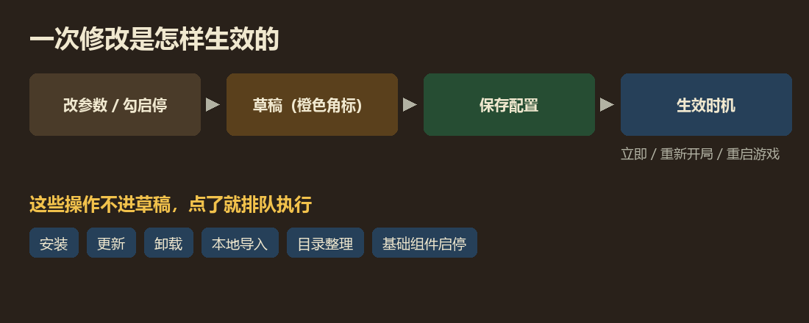
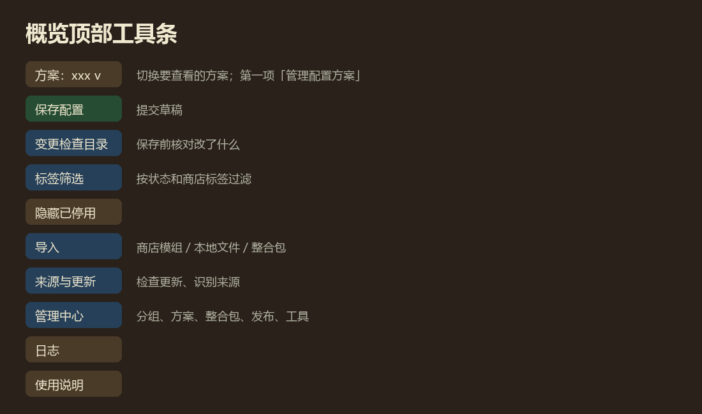
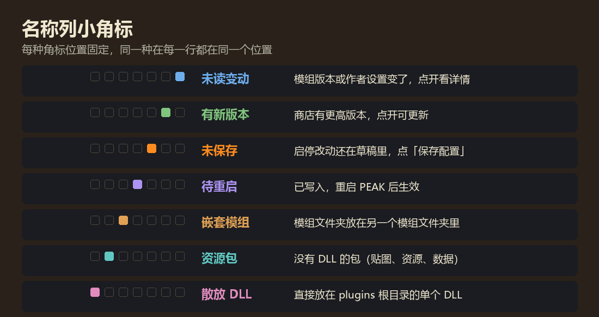
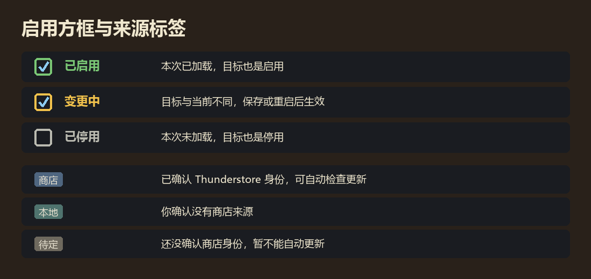

# 游戏内模组管理器 {#top}

**在游戏里查看、启停、配置和更新模组，管理整合包。**

游戏内模组管理器（In-Game Mod Manager），简称 MCE。它把模组列表、增强设置页、快捷键、翻译、商店更新和整合包工具放在同一个界面里。第一次用，先读下面的「三分钟上手」和「界面图例」，遇到不认识的词去「术语表」查。

**快速导航**　[三分钟上手](#start) · [一次修改怎样生效](#flow) · [界面图例](#legend) · [术语表](#glossary) · [安全边界](#safety) · [各章节](#chapters)

---

## 三分钟上手 {#start}

从主菜单或暂停菜单的设置里打开**模组概览**。

1. **找到模组**：在搜索框输入名称、作者或关键词，停顿一下列表就会筛选。点分组左侧的三角可以折叠。
2. **改设置**：点模组行右侧的**齿轮**进入它的设置页；改快捷键去顶部的**快捷键**页签。
3. **启用或停用**：勾选或取消行首的**启用方框**。名称右上角会出现橙色小角标，表示这项改动还在草稿里。
4. **保存**：点工具条上绿色的**保存配置**。参数按各自的生效时机使用，启停在下次启动 PEAK 时生效。

> **记住一句话：改动先进草稿，点「保存配置」才提交。**
> 浏览、切换方案、查看预览都不会顺带保存。

装新模组、更新、卸载**不走草稿**，点了就直接排队执行，见下一节。

## 一次修改怎样生效 {#flow}

MCE 里的操作分两类：

- **进草稿，保存后生效**：参数、快捷键、模组启停、分组、整合包资料、介绍。保存前可以打开**变更检查目录**核对改了什么、什么时候生效（立即、重新开局、重启游戏，或由模组决定）。
- **直接排队执行**：安装、更新、卸载、本地导入、目录整理、基础组件启停。它们交给独立的**更新助手**处理，和配置保存互不影响。

游戏运行时，新装的模组不用等退出；只有要**替换已经加载的 DLL** 时（更新正在运行的模组、回退），助手才会等你退出游戏后再完成。详见[来源与更新](sources#update-queue)。

## 界面图例 {#legend}

### 顶部工具条

按钮颜色按功能分：**绿色**提交（保存配置、保存快捷键），**红色**危险操作（卸载、删除），**蓝色**（紫色主题下是靛蓝）编辑与选择（方案、标签筛选、管理中心、语言），**青绿**（紫色主题下是青色）跳到别的窗口（模组商店、日志），**灰色**普通操作（刷新、更多），**使用说明**单独一种颜色（蓝色主题琥珀、紫色主题玫红）。

窗口变窄时，放不下的按钮会收进**更多**。管理中心里有分组、方案、整合包、发布和工具几个页签。

### 名称列小角标

每种角标有**固定位置**，同一种角标在每一行都对齐。鼠标停在角标上（或手柄聚焦）可以看说明，点开能看详情。

### 启用方框与来源标签

- 方框边框颜色表示**当前加载状态**和**目标**是否一致：绿色已启用、灰色已停用、黄色表示目标与现在不同，保存或重启后才会变。
- 资源包没有 DLL，不会显示为「已加载」，所以只要文件是启用的，方框就是绿色。
- 来源标签可以在 MCE 设置里关闭。

## 术语表 {#glossary}

- **配置方案**：一套参数、快捷键和模组启停目标。可以有很多套，切换方案只是**查看**另一套，保存后才生效。
- **作者预设**：整合包作者提供的方案，保留原版；你修改后可以原地保存或另存为个人方案，随时能恢复原版。
- **整合包**：一整套模组环境（模组文件、配置、方案、介绍）。整合包库里可以存多个，并在它们之间切换。
- **整合包资料**：分组、介绍、媒体、模组译名等，由当前整合包的所有方案共用。
- **草稿**：还没保存的改动。名称旁的橙色角标、方案名旁的 `*` 都和它有关。
- **保存**：把草稿写进方案并使用。没有单独的「应用」步骤。
- **生效时机**：保存后什么时候真正起作用：立即、重新开局、重启游戏，或由模组自己决定。
- **来源**：模组从哪来：**商店**（已确认 Thunderstore 身份，可检查更新）、**本地**（你确认没有商店版本）、**待定**（还没确认）。
- **Thunderstore**：PEAK 的模组商店，也是 r2modman、雷霆管理器使用的仓库。
- **GUID**：每个插件的唯一标识，形如 `com.作者.模组名`。MCE 用它判断是不是同一个模组。
- **manifest**：模组包里的 `manifest.json`，写着包名、作者、版本和依赖。
- **基础组件**：放在 BepInEx 的 core、patchers 等位置的共用运行库，单独列在概览顶部。
- **BepInEx**：加载模组的框架。`plugins` 放普通模组，`core`、`patchers` 放加载器和启动补丁。
- **更新助手**：执行安装、更新、卸载的独立程序。只在有任务时出现，带前台窗口，任务完成就退出。

## 安全边界 {#safety}

MCE 的原则是**提示代替拦截**：大多数检查只提醒你，由你决定是否继续。真正拦下的只有这几类：

- **白名单**：MCE 自己，以及它运行所需的 ModConfig、PEAKLib.Core、PEAKLib.UI。它们不能在 MCE 里停用或卸载，否则下次启动就打不开管理器。
- **BepInEx 核心文件**和游戏本体：只检查，不改动。
- **会伤到文件的情况**：路径越界、链接或目录联接、目标已被占用等。

其余所有模组和基础组件都可以启停和卸载。启停不弹确认；卸载会先确认一次，卸载基础组件时会额外提醒「其他模组可能依赖它」。所有文件操作都会先备份，失败会回退。

## 各章节 {#chapters}

- [模组管理](mods)：看懂列表、分组、筛选、目录整理、基础组件。
- [配置与快捷键](profiles)：方案、草稿、保存、快捷键三列。
- [来源与更新](sources)：来源识别、检查更新、更新队列与回退。
- [整合包功能](packs)：整合包库、切换、临时整合包。
- [翻译模块](translation)：语言文件、补翻、正则规则、XUnity 兼容。
- [如何打包](authoring) · [导出与发布](export)：给整合包作者。
- [常见问题](faq) · [更新日志](changelog)

本说明默认只读。开启文档编辑后，可以用介绍编辑器保存按语言独立的个人版本，详见[编辑使用说明](authoring#guide-edit)。
