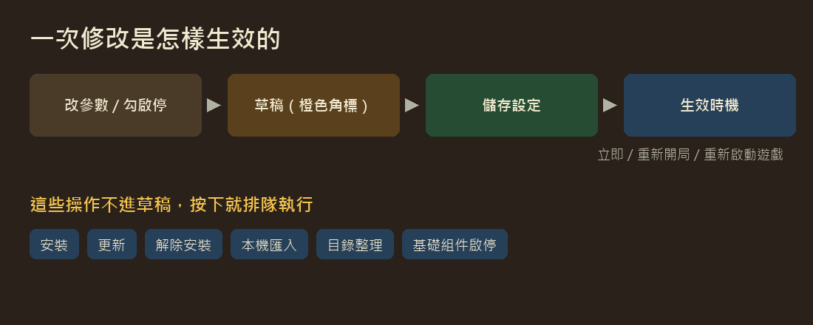
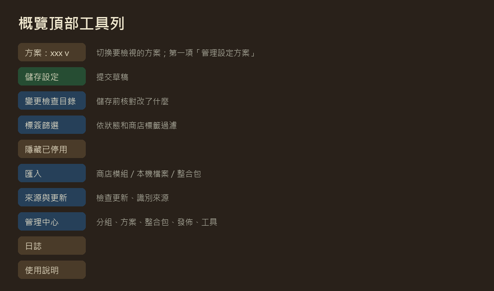
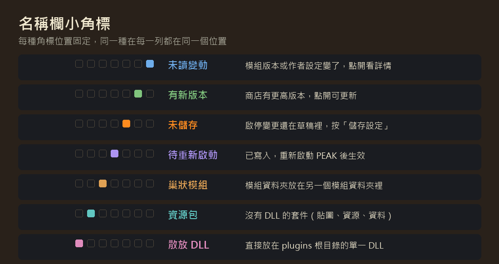
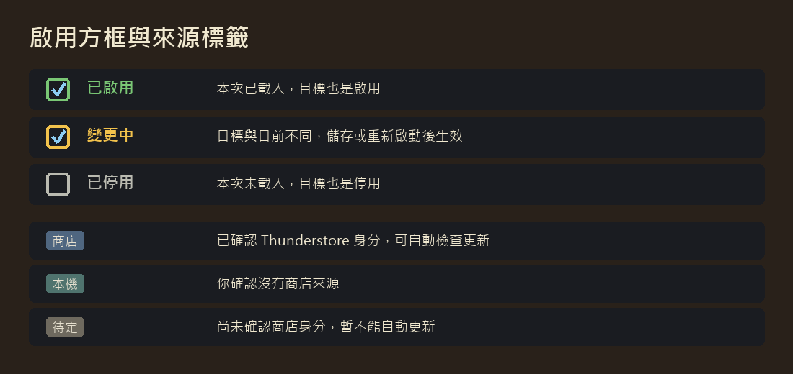

# 遊戲內模組管理器 {#top}

**在遊戲裡檢視、啟停、配置和更新模組，管理整合包。**

遊戲內模組管理器（In-Game Mod Manager），簡稱 MCE。它把模組列表、增強設定頁、快捷鍵、翻譯、商店更新和整合包工具放在同一個介面裡。第一次用，先讀下面的「三分鐘上手」和「介面圖例」，遇到不認識的詞去「術語表」查。

**快速導航**　[三分鐘上手](#start) · [一次修改怎樣生效](#flow) · [介面圖例](#legend) · [術語表](#glossary) · [安全邊界](#safety) · [各章節](#chapters)

---

## 三分鐘上手 {#start}

從主選單或暫停選單的設定裡開啟**模組概覽**。

1. **找到模組**：在搜尋框輸入名稱、作者或關鍵詞，停頓一下列表就會篩選。點分組左側的三角可以摺疊。
2. **改設定**：點模組行右側的**齒輪**進入它的設定頁；改快捷鍵去頂部的**快捷鍵**頁籤。
3. **啟用或停用**：勾選或取消行首的**啟用方框**。名稱右上角會出現橙色小角標，表示這項改動還在草稿裡。
4. **儲存**：點工具列上綠色的**儲存設定**。參數按各自的生效時機使用，啟停在下次啟動 PEAK 時生效。

> **記住一句話：改動先進草稿，點「儲存設定」才提交。**
> 瀏覽、切換方案、檢視預覽都不會順帶儲存。

裝新模組、更新、解除安裝**不走草稿**，點了就直接排隊執行，見下一節。

## 一次修改怎樣生效 {#flow}

MCE 裡的操作分兩類：

- **進草稿，儲存後生效**：參數、快捷鍵、模組啟停、分組、整合包資料、介紹。儲存前可以開啟**變更檢查目錄**核對改了什麼、什麼時候生效（立即、重新開局、重新啟動遊戲，或由模組決定）。
- **直接排隊執行**：安裝、更新、解除安裝、本機匯入、目錄整理、基礎組件啟停。它們交給獨立的**更新助手**處理，和設定儲存互不影響。

遊戲執行時，新裝的模組不用等退出；只有要**替換已經載入的 DLL** 時（更新正在執行的模組、回退），助手才會等你退出遊戲後再完成。詳見[來源與更新](sources#update-queue)。

## 介面圖例 {#legend}

### 頂部工具列

按鈕顏色按功能分：**綠色**提交（儲存設定、儲存快捷鍵），**紅色**危險操作（解除安裝、刪除），**藍色**（紫色主題下是靛藍）編輯與選擇（方案、標籤篩選、管理中心、語言），**青綠**（紫色主題下是青色）跳到別的視窗（模組商店、日誌），**灰色**一般操作（重新整理、更多），**使用說明**單獨一種顏色（藍色主題琥珀、紫色主題玫紅）。

視窗變窄時，放不下的按鈕會收進**更多**。管理中心裡有分組、方案、整合包、發佈和工具幾個頁籤。

### 名稱欄小角標

每種角標有**固定位置**，同一種角標在每一行都對齊。滑鼠停在角標上（或控制器聚焦）可以看說明，點開能看詳情。

### 啟用方框與來源標籤

- 方框邊框顏色表示**目前載入狀態**和**目標**是否一致：綠色已啟用、灰色已停用、黃色表示目標與現在不同，儲存或重新啟動後才會變。
- 資源包沒有 DLL，不會顯示為「已載入」，所以只要檔案是啟用的，方框就是綠色。
- 來源標籤可以在 MCE 設定裡關閉。

## 術語表 {#glossary}

- **設定方案**：一套參數、快捷鍵和模組啟停目標。可以有很多套，切換方案只是**檢視**另一套，儲存後才生效。
- **作者預設**：整合包作者提供的方案，保留原版；你修改後可以原地儲存或另存為個人方案，隨時能還原原版。
- **整合包**：一整套模組環境（模組檔案、配置、方案、介紹）。整合包庫裡可以存多個，並在它們之間切換。
- **整合包資料**：分組、介紹、媒體、模組譯名等，由目前整合包的所有方案共用。
- **草稿**：還沒儲存的改動。名稱旁的橙色角標、方案名旁的 `*` 都和它有關。
- **儲存**：把草稿寫進方案並使用。沒有單獨的「應用」步驟。
- **生效時機**：儲存後什麼時候真正起作用：立即、重新開局、重新啟動遊戲，或由模組自己決定。
- **來源**：模組從哪來：**商店**（已確認 Thunderstore 身份，可檢查更新）、**本機**（你確認沒有商店版本）、**待定**（還沒確認）。
- **Thunderstore**：PEAK 的模組商店，也是 r2modman、雷霆管理器使用的倉庫。
- **GUID**：每個插件的唯一標識，形如 `com.作者.模組名`。MCE 用它判斷是不是同一個模組。
- **manifest**：模組包裡的 `manifest.json`，寫著包名、作者、版本和依賴。
- **基礎組件**：放在 BepInEx 的 core、patchers 等位置的共用執行庫，單獨列在概覽頂部。
- **BepInEx**：載入模組的框架。`plugins` 放普通模組，`core`、`patchers` 放載入器和啟動補丁。
- **更新助手**：執行安裝、更新、解除安裝的獨立程式。只在有任務時出現，帶前臺視窗，任務完成就退出。

## 安全邊界 {#safety}

MCE 的原則是**提示代替攔截**：大多數檢查只提醒你，由你決定是否繼續。真正攔下的只有這幾類：

- **白名單**：MCE 自己，以及它執行所需的 ModConfig、PEAKLib.Core、PEAKLib.UI。它們不能在 MCE 裡停用或解除安裝，否則下次啟動就打不開管理器。
- **BepInEx 核心檔案**和遊戲本體：只檢查，不改動。
- **會傷到檔案的情況**：路徑越界、連結或目錄聯接、目標已被佔用等。

其餘所有模組和基礎組件都可以啟停和解除安裝。啟停不彈確認；解除安裝會先確認一次，解除安裝基礎組件時會額外提醒「其他模組可能依賴它」。所有檔案操作都會先備份，失敗會回退。

## 各章節 {#chapters}

- [模組管理](mods)：看懂列表、分組、篩選、目錄整理、基礎組件。
- [設定與快捷鍵](profiles)：方案、草稿、儲存、快捷鍵三列。
- [來源與更新](sources)：來源識別、檢查更新、更新佇列與回退。
- [整合包功能](packs)：整合包庫、切換、臨時整合包。
- [翻譯模組](translation)：語言檔案、補翻、正則規則、XUnity 相容。
- [如何打包](authoring) · [匯出與發佈](export)：給整合包作者。
- [常見問題](faq) · [更新日誌](changelog)

本說明預設唯讀。開啟文件編輯後，可以用介紹編輯器儲存按語言獨立的個人版本，詳見[編輯使用說明](authoring#guide-edit)。
