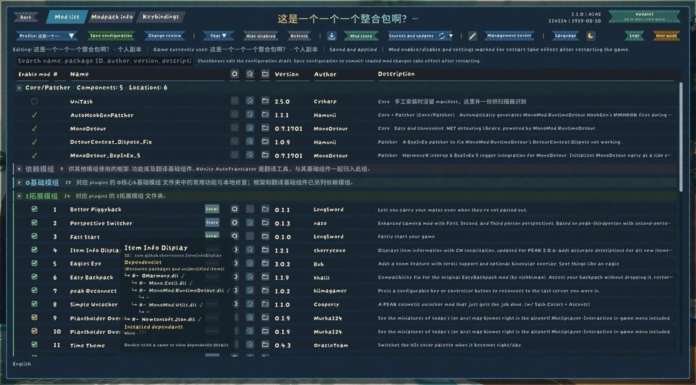
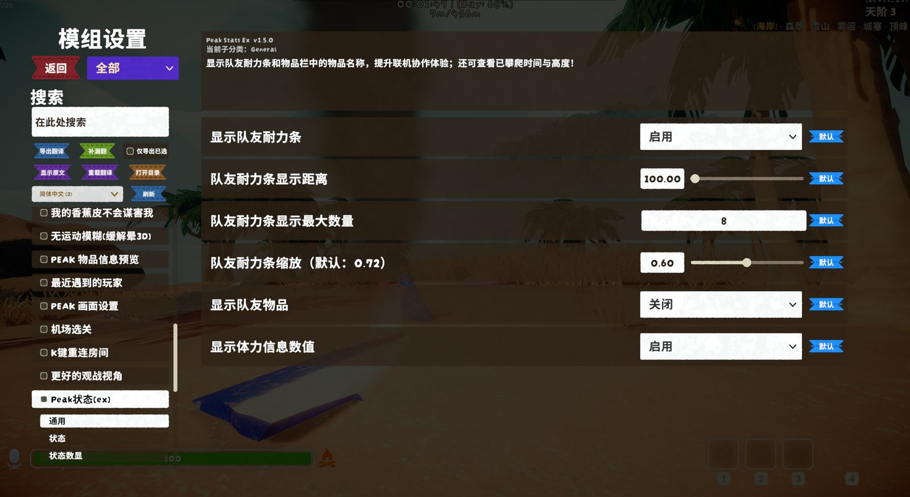

# 游戏内模组管理器

不用退出游戏、不用开管理器，在 PEAK 的设置菜单里就能看到装了哪些模组、各自是什么版本、谁依赖谁，改配置、改快捷键、更新、启停、卸载，都在同一个界面里完成。

**[查看完整介绍](文档/介绍页/index.html)**

---

### 模组管理

一页看全所有模组，哪个有更新、哪个没生效、谁依赖谁，一眼就知道。

- **按分组排列**：分组可以嵌套三层，拖动就能调整；首次进入会按你现有的文件夹自动分好组。
- **状态角标**：有更新、改了没保存、等重启、资源包……每种状态一个颜色，位置固定。
- **一键启停**：勾选即可，不用手动改文件名；同一个模组装了两份时，选一份用，另一份自动停用。
- **更新、安装、卸载**：直接从雷霆商店检查和下载。要替换正在运行的文件时，等你退出游戏后由小助手完成，改动前全部备份，出问题可以回退。
- **依赖与主页**：悬停看依赖关系，点主页按钮跳到模组的商店页或项目页。
- **目录整理**：按分组把 plugins 文件夹整理好，只移动、不改名，执行前先看预览。

### 模组配置

所有模组的设置集中在一棵树里，找得到、改得明白。

- **树形侧栏**：按分组和模组排列，可以搜索、可以置顶常用的模组。
- **说明面板**：选中一个设置项，上方显示它的说明、默认值和可选范围。
- **快捷键集中管理**：所有模组的快捷键放在同一页，重复的按键会标出来，点一下直接录新按键。
- **先改后存**：改动先放进草稿，保存前能在「变更检查目录」核对改了什么、什么时候生效（立即、重新开局还是要重启）。

### 多配置切换

同一套模组可以有好几套配置，比如「日常」和「整活」，随时切换。

- **配置方案**：每套方案记下所有参数、快捷键和模组的开关。
- **切换只是查看**：切过去先看，确认要用再保存，不会误改。
- **作者预设与个人修改分开**：整合包作者给的预设保持原样，你自己的修改另存一份，随时能恢复作者的设置。

### 整合包

把一整套模组环境存起来，换着玩，也能打包发给朋友。

- **整合包库**：可以存好几套完整的模组环境，每套保留自己的模组版本和配置。
- **导入先预览**：导入时先看里面有什么、缺什么依赖，存进库里不会动你现在的游戏文件。
- **切换有备份**：切换时会先保存当前环境，退出游戏后自动完成替换，随时能切回来。
- **写介绍**：给整合包写图文介绍，支持图片、动图和视频，玩家打开就能看到。
- **发布**：导出成本地完整包，或者雷霆商店包（商店里有的模组自动写成依赖）；可以给作者资料签名，防止被改。

### 多语言翻译

界面和模组的名字、说明都能翻译，补翻也很方便。

- **内置三种语言**：英文、简体中文、繁体中文，不装语言文件也能用。
- **模组名称和说明也能翻**：在列表里双击名称或简介就能改成你习惯的译名。
- **一键导出待翻文本**：导出全部或只导出还没翻的，填好点「导入补翻」直接合进语言文件。
- **跟着整合包走**：整合包作者补好的译文会随包一起发给玩家。
- **不需要 XUnity**：模组设置页的选项名、分区和下拉选项也由管理器自己翻译；只差数字的句子可以写正则规则。装了 XUnity 并开着在线机翻时会提醒，可以一键关掉。

---

### 安装

用 r2modman 或雷霆商店管理器一键安装，依赖会自动装好。进游戏后，在主菜单或暂停菜单的「设置」里打开「模组概览」。

**不推荐手动安装**：依赖比较多，有的还要放进 BepInEx 的 core 文件夹。请用模组管理器安装；自动部署脚本以后会放在 GitHub 页面上。

---

**[完整介绍、截图和使用说明](文档/介绍页/index.html)**　·　[更新日志](CHANGELOG.md)　·　[问题反馈](https://github.com/AiAe-156/Peak-InGameModManager/issues)

---

## Release notes / 版本说明

## 1.0.0 首发

游戏内模组管理器（In-Game Mod Manager）第一个正式版本：不退出游戏就能管理 PEAK 的模组、设置、快捷键、翻译、商店更新和整合包。

**从 ModConfig Enhance 过来的用户：**

- 第一次启动会把 `BepInEx/config/ModConfigEnhance/` 里的设置、语言文件、配置方案和介绍**复制**到 `BepInEx/config/InGameModManager/`，原文件夹保持不动，留给 ModConfig Enhance。旧的整合包导出文件不复制，日志里会写出它们的位置。
- 工作目录 `BepInEx/MCE/`（更新队列、整合包库、商店记录）改名为 `BepInEx/IGMM/`。
- ModConfig Enhance 发布的整合包、作者资料（`MCEPack` 文件夹）、带 `MCE_` 键的语言文件仍然可以读取。
- 两个一起开会把设置页改两遍，两边都会提醒，停用其中一个即可。

更早的开发版说明已归档。
